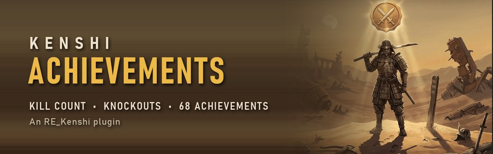
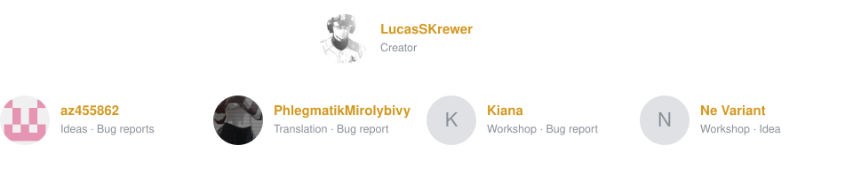

[](https://steamcommunity.com/sharedfiles/filedetails/?id=3809336824)

# Kenshi Achievements

[](https://github.com/LucasSKrewer/kenshi-achievements/releases/latest)
[](https://steamcommunity.com/sharedfiles/filedetails/?id=3809336824)
[](https://github.com/BFrizzleFoShizzle/RE_Kenshi/releases)
[](LICENSE)

[English](README.md) · **Português (Brasil)**

Plugin [RE_Kenshi](https://github.com/BFrizzleFoShizzle/RE_Kenshi) que conta as **mortes** e os **nocautes**
feitos pelo seu grupo e libera **conquistas** configuráveis. Só single-player.

**[Steam Workshop](https://steamcommunity.com/sharedfiles/filedetails/?id=3809336824)** ·
**[Download (releases no GitHub)](https://github.com/LucasSKrewer/kenshi-achievements/releases/latest)** ·
[Changelog](CHANGELOG.md) · [Issues](https://github.com/LucasSKrewer/kenshi-achievements/issues)

⭐ **Gostou? Deixa uma estrela no repositório.** É o único pedido. Fork à vontade.

**Conteúdo:** [Recursos](#recursos) · [Instalar](#instalar) · [Personalizar](#personalizar) ·
[Idiomas](#idiomas) · [Como a autoria é decidida](#como-a-autoria-é-decidida) · [Compilar](#compilar) ·
[Créditos](#créditos)

## Recursos

- Conta por personagem e pela raça e facção da vítima: mortes, nocautes (os furtivos à parte) e membros
  decepados.
- **68 conquistas** nestes grupos:
  - marcos de mortes e nocautes;
  - sequências ("5 mortes em um minuto");
  - facções e criaturas;
  - chefes e NPCs únicos;
  - conteúdo do Genesis.

  As conquistas de conteúdo que você não tem instalado ficam ocultas.
- Quando uma conquista é liberada, aparece um aviso no topo da tela, uma linha no log de mensagens e um som.
- **F6** abre e fecha o painel (a tecla muda com `@key`). Ele tem quatro abas:
  - **Estatísticas**: o personagem selecionado, o total do grupo e as vítimas mais frequentes em cima, e
    uma **tabela por personagem** (Mortes, KOs, Furtivos, Membros) embaixo. Clique no cabeçalho pra ordenar.
  - **Conquistas**: por categoria, concluídas e em andamento, com o progresso, como `(3/10)`.
  - **Memorial**: quem do grupo morreu, quem matou, em que dia e o que tinha feito.
  - **Vítimas**: todas as raças e facções que o grupo matou ou nocauteou, em duas tabelas ordenáveis, do
    grupo todo ou só do personagem selecionado.
- Botão **Exportar**: grava tudo em `exports/stats-<data>.txt` e `.csv` (abre no Excel) na pasta do mod.
- Os contadores ficam **dentro do save** (num registro `GameData` do tipo próprio do mod, `4242`), então
  cada save tem os seus. Saves de antes do mod carregam normalmente, e a contagem começa dali.
- **Tudo é configurável** no `achievements.txt`, sem recompilar (veja [Personalizar](#personalizar)).

## Instalar

Requer o **[RE_Kenshi](https://github.com/BFrizzleFoShizzle/RE_Kenshi/releases) v0.3.5 ou mais novo**.
O menu principal mostra "RE_Kenshi v0.3.5" quando ele está instalado.

**Steam:** assine na [Steam Workshop](https://steamcommunity.com/sharedfiles/filedetails/?id=3809336824)
e ative **KenshiAchievements** no launcher do Kenshi.

**Manual (GOG etc.):**
1. Baixe o zip em [Releases](https://github.com/LucasSKrewer/kenshi-achievements/releases/latest).
2. Copie a pasta `KenshiAchievements` para `Kenshi\mods\`.
3. Ative **KenshiAchievements** no launcher do Kenshi.

**Atualizar:** troque a pasta. O progresso fica nos seus saves e é mantido.

**Remover o mod é seguro:** os saves carregam normalmente sem ele. Um save feito *com o mod desativado*
perde os contadores, porque o Kenshi descarta os registros que não conhece ao salvar. Os saves antigos
mantêm os deles.

A ordem de carregamento não importa: o mod não muda nenhum dado do jogo. Funciona com o Genesis e com as
listas de mods comuns da Workshop. Não foi feito pra mods de multiplayer.

## Personalizar

Tudo fica em `mods/KenshiAchievements/achievements.txt`, que o jogo lê ao abrir. O formato está explicado
no topo do arquivo:

```
id | métrica | meta | título | descrição
```

| Métrica | Conta |
|---|---|
| `kills`, `kos`, `takedowns` | o grupo todo (takedowns = mortes + nocautes) |
| `limbs`, `stealth_kos`, `squad_deaths` | membros decepados, nocautes furtivos, membros do grupo perdidos |
| `char_kills`, `char_kos`, `char_limbs`, `char_stealth_kos` | o melhor personagem sozinho |
| `race_kills:<Raça>`, `race_kos:<Raça>` | ex.: `race_kills:Shek` |
| `faction_kills:<Facção>`, `faction_kos:<Facção>` | ex.: `faction_kills:The Holy Nation` |
| `npc_kills:<Nome>`, `npc_kos:<Nome>`, `npc_takedowns:<Nome>` | só NPCs únicos, ex.: `npc_takedowns:Tinfist` |
| `burst_kills:<s>`, `burst_takedowns:<s>` | mais mortes (ou mortes + nocautes) em `<s>` segundos de tempo de jogo |

Regras dos nomes:
- Raças, facções e NPCs usam sempre o nome do jogo **em inglês**, em qualquer idioma que você jogue.
- `*` vale qualquer coisa, ex.: `*Skeleton*` pega Skeleton MKI, MKII...
- `,` separa alternativas, ex.: `Dust Bandits,Hungry Bandits`.

Outras opções:
- `[Nome]` começa uma categoria.
- `?id` deixa a conquista secreta: aparece como `???` até ser liberada.

Configurações no mesmo arquivo:

| Configuração | O que faz |
|---|---|
| `@key = F6` | tecla do painel: F1–F12, uma letra/número ou NUM0–NUM9 |
| `@sound = Notifications:Building_Complete` | som da conquista: um evento de som do Kenshi (padrão, segue o volume do jogo), qualquer `.wav` na pasta do mod (o `achievement.wav` vem incluso) ou `none` |
| `@victims = 5` | quantas raças e facções a lista "Vítimas mais frequentes" mostra; um número ou `all` |
| `@debug = 0` | `1` registra cada morte, nocaute e golpe no `RE_Kenshi_log.txt`, pra relatar bugs |

Nunca mude o `id` de uma conquista depois de jogar com ela: os saves guardam as conquistas liberadas pelo id.

## Idiomas

O mod segue o idioma escolhido no Kenshi (`language=` no `settings.cfg`):

- **Os textos do próprio mod** vêm de `lang/<idioma>.txt` (ex.: `pt_BR.txt`), por cima do `lang/en.txt`.
  Inclusos: inglês e português (Brasil).
- **Os nomes de raça e facção** chegam traduzidos pelo jogo ("Bandidos da Poeira"). O mod usa o dicionário
  do próprio Kenshi (`locale/<idioma>/gamedata.po`) pra voltar ao inglês ("Dust Bandits"). Por isso o
  `achievements.txt` é o mesmo em qualquer idioma.

**Traduções são bem-vindas!** Copie o `en.txt`, dê à cópia o código do idioma e traduza. O que você deixar
de fora fica em inglês. Veja a [#15](https://github.com/LucasSKrewer/kenshi-achievements/issues/15).

## Como a autoria é decidida

Quando alguém morre (`Character::declareDead`) ou é nocauteado, o mod procura o atacante nesta ordem:

1. Um membro do grupo fazendo **nocaute ou assassinato furtivo** na vítima. O golpe furtivo não fere a
   vítima, então isso é conferido primeiro.
2. `vítima->lastGuyWhoDefeatedMe`, se for um dos seus personagens.
3. Senão, o último membro do grupo que **feriu** a vítima (`MedicalSystem::addWound`, corpo a corpo ou à
   distância) nos últimos 30 segundos.

Detalhes:
- **Nocautes.** Cair por dano não passa pela função de nocaute do jogo, então o mod confere a cada 250 ms
  se uma vítima que o grupo acertou há pouco caiu.
- **Esperando o atacante.** Um nocaute ainda sem atacante espera até 3 s, porque o jogo costuma preencher o
  atacante logo depois.
- **Vítimas caídas.** Se a vítima morre ainda caída, a morte é de quem a derrubou. Por exemplo, carnear um
  animal nocauteado não dá a morte pra quem saqueou, e um animal derrubado por alguém de fora não conta pra você.
- **O que não conta.** Os membros do seu grupo nunca contam como vítimas, e cada morte conta uma vez só. Os
  membros do grupo que morrem vão pro Memorial.

## Compilar

Os plugins do KenshiLib **precisam** do compilador do Visual Studio 2010 (toolset `v100`, x64): o Kenshi
foi compilado com ele, e o plugin divide a STL/CRT com o jogo. Mantenha o código compatível com o VS2010:
nada de range-for, initializer list ou `enum class`. Os fontes são UTF-8 sem BOM.

### Compilador (sem Visual Studio, sem admin)

Dá pra **extrair** o VC++ 2010 x64 do Windows SDK 7.1 em vez de instalar:

1. Baixe a ISO oficial `GRMSDKX_EN_DVD.iso` (SDK 7.1 x64, 571 MB) do download.microsoft.com e monte.
2. Extraia `Setup\vc_stdamd64`, `Setup\vc_stdx86` e `Setup\WinSDKBuild_amd64` com o
   [lessmsi](https://github.com/activescott/lessmsi) (`lessmsi x <msi> <pasta>\`).
3. Monte uma pasta `vc2010\`:

   | Pasta em `vc2010\` | Copiar de |
   |---|---|
   | `bin\amd64` | `vc_stdamd64\...\VC\bin\amd64`, mais `Win\System64\msvcr100.dll` |
   | `include` e `lib\amd64` | `vc_stdx86\...\VC` |
   | `sdk\include` e `sdk\lib\x64` | `...\Windows\v7.1` |

   O resultado é o cl 16.00.30319.01.

O `KenshiAchievements.vcxproj` continua no repositório, pra quem tem o Visual Studio com o toolset v100.

### Dependências (`deps/`, fora do git)

- `deps/KenshiLib`: clone do [BFrizzleFoShizzle/KenshiLib](https://github.com/BFrizzleFoShizzle/KenshiLib)
  na tag **v0.5.1**, com o `KenshiLib.lib` do zip da release copiado em `Libraries/`.
  **Tem que bater com o KenshiLib.dll instalado no jogo.** Veja `scripts/atualizar-rekenshi.ps1`.
- `deps/boost_1_60_0`: o `boost.zip` do
  [KenshiLib_Examples_deps](https://github.com/BFrizzleFoShizzle/KenshiLib_Examples_deps) (git LFS),
  que já vem com o `stage/lib` vc100.

### Build

```
powershell -ExecutionPolicy Bypass -File build.ps1 -VcDir <pasta do vc2010> -KenshiDir <pasta do Kenshi>
```

A DLL sai em `mod/KenshiAchievements/`, e a pasta do mod é copiada para
`<Kenshi>\mods\KenshiAchievements`. Use `-NoInstall` pra só compilar. O plugin escreve no
`RE_Kenshi_log.txt` da pasta do jogo, com o prefixo `KenshiAchievements:`.

### Testes (sem o jogo)

```
powershell -ExecutionPolicy Bypass -File tests\rodar-testes.ps1
```

Compila o `tests/teste_logica.cpp` com o mesmo VC++ 2010. Testa:
- o dicionário de nomes (inclusive o russo, cujo `gamedata.po` não tem `msgctxt`) e os textos por idioma;
- a contagem, as conquistas e a junção de personagens;
- o texto das abas do painel.

Notas de manutenção (publicar na Workshop, o que já foi validado no jogo): [docs/manutencao.md](docs/manutencao.md).

## Licença

[GPLv3](LICENSE), a mesma do [KenshiLib](https://github.com/BFrizzleFoShizzle/KenshiLib), ao qual o plugin
é ligado. Pode usar, modificar e forkar; forks distribuídos continuam abertos sob a GPLv3. Se for útil pra
você, deixa uma ⭐: ajuda outras pessoas a achar o mod.

## Créditos

- [BFrizzleFoShizzle](https://github.com/BFrizzleFoShizzle), pelo RE_Kenshi e pelo KenshiLib, sem os quais
  nada disso existe.
- Quem relatou bugs e sugeriu ideias, no GitHub e nos comentários da Workshop:

  [](https://github.com/LucasSKrewer/kenshi-achievements/issues?q=is%3Aissue)

  O painel se atualiza sozinho pelo GitHub (commits e issues). Quem contribuiu pela Workshop fica em
  [`.github/contributors.json`](.github/contributors.json).
- Kenshi © Lo-Fi Games. Este projeto não inclui nenhum arquivo do jogo. O `achievement.wav` é sintetizado
  pelo `scripts/gerar-som.py`.
